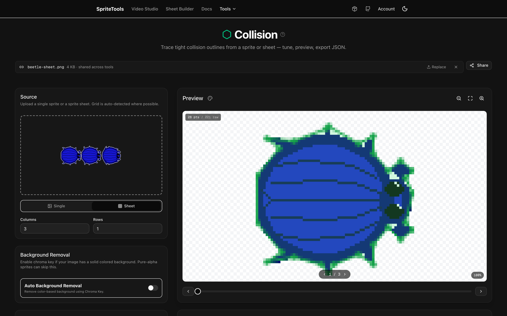
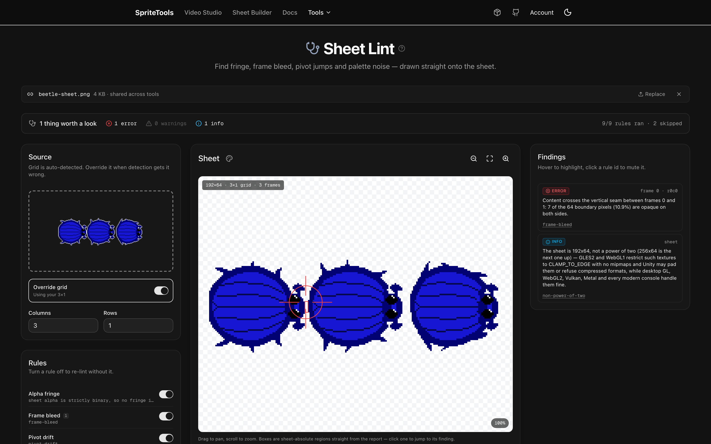
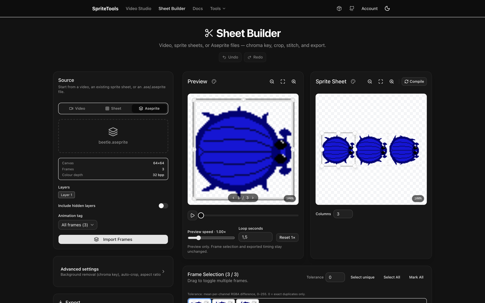
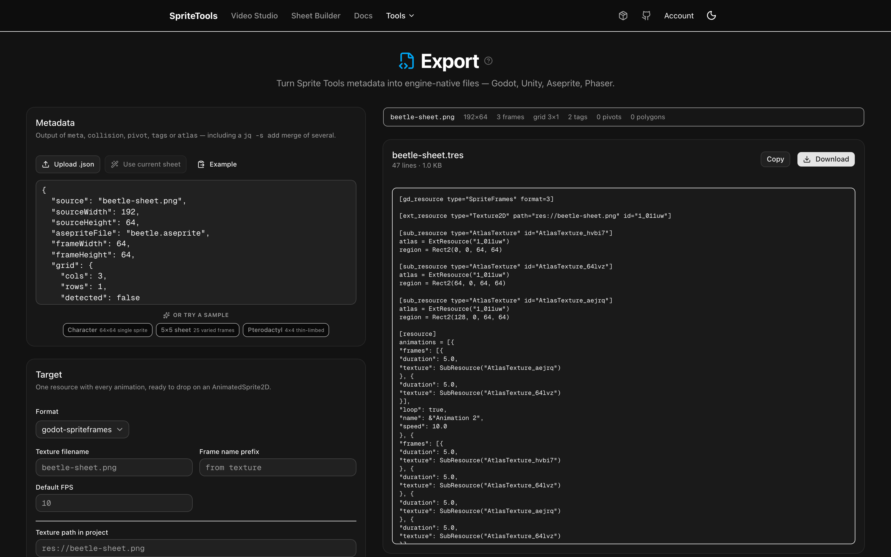
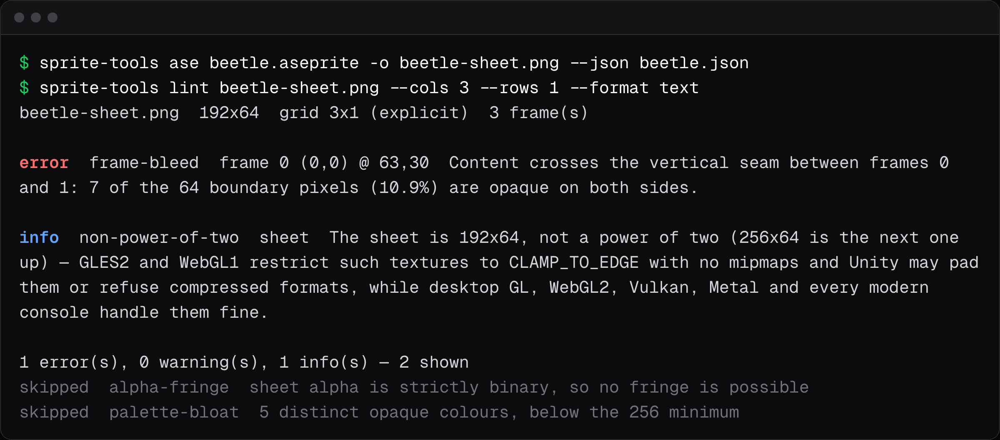

# Sprite Tools

[](https://github.com/trebeljahr/sprite-tools/actions/workflows/ci.yml)
[](#license)
[](#install-the-cli-and-mcp-server)

Your sprite is drawn, but your engine still needs collision polygons, pivots, animation tags and an import file. Sprite Tools makes that data from the PNG, GIF, video or `.aseprite` file you already have. It writes JSON, or files that Godot, Unity, Aseprite and Phaser import directly.

It also checks and cleans the sheet itself. Sheet Lint finds frame bleed, alpha fringe and pivot jumps, and draws each finding onto the sheet. Other tools remove flat backgrounds, drop duplicate frames, pack atlases, add outlines, derive normal maps for 2D lighting and convert art to limited-palette pixel art.

Open **[sprites.trebeljahr.com](https://sprites.trebeljahr.com)** to use the tools in the browser, without an account. Images stay in the page unless you start one of the optional AI flows. The same code runs as the `sprite-tools` CLI and as an [MCP](https://modelcontextprotocol.io) server. A build script or an AI agent gets the same JSON as the web app.



## Try it online

Good starting points at [sprites.trebeljahr.com](https://sprites.trebeljahr.com):

- [Sheet Lint](https://sprites.trebeljahr.com/lint) — the one to open first: what a sheet is, and what is wrong with it, drawn onto the sheet.
- [Sheet Builder](https://sprites.trebeljahr.com/spritesheet) — turn video, GIF, loose frames, or an `.aseprite` file into a clean sheet.
- [Background Removal](https://sprites.trebeljahr.com/background-removal) — chroma-key a flat background out of every frame.
- [Collision](https://sprites.trebeljahr.com/collision) — trace tight polygons for physics engines.
- [Pixelate](https://sprites.trebeljahr.com/pixelate) — convert sprites into limited-palette pixel art, or upscale existing pixel art with Scale2x, Scale3x, Eagle, or xBR.
- [Outline & Shadow](https://sprites.trebeljahr.com/outline) — add an outline and a drop shadow to a sprite or a sheet.
- [Atlas](https://sprites.trebeljahr.com/atlas) — pack loose sprites into one PNG plus JSON.
- [Export](https://sprites.trebeljahr.com/export) — turn that metadata into a Godot, Unity, Aseprite, or Phaser file.
- [Docs](https://sprites.trebeljahr.com/docs) — quickstart, CLI reference, MCP setup, schemas, and algorithm notes.

Every tool is free and works without an account. AI Character makes images with your own xAI key (no account) or with prepaid AI credit, priced at xAI's list price plus a stated margin. An account is only for that credit.

| Sheet Lint | Aseprite import | Engine export |
| --- | --- | --- |
| [](docs/marketing/screenshots/lint-desktop.png) | [](docs/marketing/screenshots/aseprite-import-desktop.png) | [](docs/marketing/screenshots/export-desktop.png) |

## Project status

Sprite Tools is actively maintained. The deployed web app is the interactive reference implementation for the same algorithms the CLI and MCP server run. The npm package `@trebeljahr/sprite-tools` is not published yet, so the CLI and MCP server install from a source checkout for now. Issues, bug reports, and focused pull requests are welcome.

## Quick taste



```bash
# Start here on a sheet you know nothing about: detected grid, frame count, findings
sprite-tools lint unknown-sheet.png --format text

# Gate CI on it — exit 1 on error-severity findings, full JSON report still on stdout
sprite-tools lint hero.png > lint-report.json

# Auto-detect grid, generate collision polygons + pivots + tags in one shot
sprite-tools meta hero.png \
  --collision --tolerance 4 \
  --pivot bottom-center \
  --tag idle=0-3 \
  --tag run=4-7:12:pingpong \
  --tag attack=8-11 \
  -o hero.json

# Slice a tileset that has a 1px border and 2px gutters between cells
sprite-tools slice tileset.png --cols 8 --rows 6 --margin 1 --spacing 2 --out-dir tiles

# Read an .aseprite file: one tag as a sheet PNG, plus tags, frame durations, layers, and palette as JSON
sprite-tools ase hero.aseprite --tag run -o run-sheet.png --json run.json
# That JSON is sheet metadata, so export reads it and keeps Aseprite's frame durations
sprite-tools export run.json --format godot -o run.tres

# Chroma-key a flat background out and crop to the content
sprite-tools chroma hero.png --color '#00ff00' --trim -o hero-cut.png

# Guess nine-slice borders for a UI panel, then check them with a stretched preview
sprite-tools nine-slice panel.png --preview panel-stretched.png -o panel-9s.json

# Drop repeated frames from a video extraction and rewrite the tag ranges to match
sprite-tools dedupe walk-sheet.png --cols 8 --rows 4 --threshold 1 \
  --tags walk-tags.json --tags-out walk-tags-deduped.json \
  --sheet walk-deduped.png -o dedupe.json

# Hand that metadata to an engine — Godot 4 SpriteFrames, Unity .meta, Aseprite, Phaser
sprite-tools export hero.json --format godot -o hero.tres

# Turn any sprite into Game Boy pixel art
sprite-tools pixelate hero.png --pixel-size 4 --palette gameboy --dither -o hero-gb.png

# Add a 2px outline and a soft drop shadow
sprite-tools outline hero.png --width 2 --shadow --shadow-blur 2 -o hero-fx.png

# Upscale existing pixel art 4x with Scale2x (no downscale, no quantization)
sprite-tools pixelate hero.png --pixel-size 1 --colors 0 --upscale-algo scale2x --upscale-factor 4 -o hero-4x.png

# Derive a normal map for 2D lighting
sprite-tools normal-map hero.png -o hero-normal.png

# Re-tint a whole shading ramp, then spin out 8 enemy color variants + a manifest
sprite-tools palette hero.png --ramp '#4d7faf=#af4d4d' --image hero-red.png
sprite-tools palette hero.png --hue-variants 8 --out-dir variants --manifest variants/hero.json

# Pack a folder of loose sprites into an atlas + TexturePacker manifest
# (sprite edges are extruded 1px into the gutter by default — no filtering halos)
sprite-tools atlas sprites/*.png -o atlas.png --json atlas.json

# Pipe stdin to stdout
cat hero.png | sprite-tools trim - -o - | sprite-tools collision -
```

## Install the CLI and MCP server

The package name is `@trebeljahr/sprite-tools`. One install ships both the `sprite-tools` CLI and the `sprite-tools-mcp` server. It is not on npm yet, so build it from a checkout:

```bash
git clone https://github.com/trebeljahr/sprite-tools.git
cd sprite-tools
pnpm install

# Build the web app, CLI and MCP server, then link both binaries onto your PATH
pnpm install-local

# …or run a command uncompiled, against the TypeScript source
pnpm cli:dev -- lint my-sheet.png --format text
```

Requires **Node 20+** and pnpm. PNG I/O is pure JS. Video Studio additionally requires `ffmpeg` and `ffprobe` on your PATH. More install options (MCP client config, building from source) live in the [install docs](https://sprites.trebeljahr.com/docs/install).

## Local Video Studio

Run `sprite-tools studio`, open its private setup link, and add a Google or xAI key to the encrypted local vault. Set a total and per-job spending limit before generating. The default budget is zero.

The local Web UI accepts prompts, concept art, and supported first/end frame controls. One job generates video, removes the background, and exports a sprite sheet with timing, pivots, collision polygons, and bounding hitboxes. Existing video can be imported or reprocessed without generation charges.

Local MCP clients use the same running companion through six `sprite_video_*` tools. Keys stay out of chat and tool arguments. See [the runtime and security contract](docs/video-studio.md).

## MCP in Claude Desktop

Add to `claude_desktop_config.json` (macOS path: `~/Library/Application Support/Claude/claude_desktop_config.json`):

```json
{
  "mcpServers": {
    "sprite-tools": { "command": "sprite-tools-mcp" }
  }
}
```

Restart Claude Desktop — the sprite tools appear under the MCP menu. If `sprite-tools-mcp` isn't on the PATH Claude sees (common with `nvm`/`fnm`), set `command` to the absolute path printed by `which sprite-tools-mcp`.

## What's in the box

**Character layers**: [prepare and review articulated artwork](https://sprites.trebeljahr.com/docs/character-layers) through `/character-layers`, `sprite-tools character`, or `sprite_prepare_character_layers`. Local plans preserve source pixels; optional xAI drafts and hidden-area completion require explicit paid actions.

**Web app**: `/character-layers`, `/spritesheet`, `/background-removal`, `/lasso`, `/lint`, `/collision`, `/pivot`, `/tags`, `/nine-slice`, `/pixelate`, `/normal-map`, `/outline`, `/palette`, `/atlas`, `/gif`, `/export`, `/motion-workbench`, `/generate` (AI Character), and `/animate` (AI Animation).

**CLI**: `lint`, `info`, `detect`, `slice`, `trim`, `aseprite` (alias `ase`), `dedupe`, `chroma` (alias `remove-bg`), `collision`, `pivot`, `tags`, `nine-slice`, `meta`, `palette`, `pixelate`, `normal-map`, `outline`, `atlas`, `gif`, `export`, `character`, `motion`, `inbetween`, and `studio`.

**MCP**: 31 tools with typed Zod input schemas (`outline` splits into `sprite_add_outline` and `sprite_add_shadow`; palette adds `sprite_detect_ramps` and `sprite_palette_variants`; `aseprite` is `sprite_read_aseprite`; Video Studio adds six `sprite_video_*` tools).

## Docs

Full docs live in the app at [sprites.trebeljahr.com/docs](https://sprites.trebeljahr.com/docs). Highlights:

- **Quickstart** — 5 minutes end-to-end.
- **Install** — web app, CLI, MCP, npm, and source setup.
- **Web app guide** — Sheet Builder, Background Removal, Lasso, metadata tools, transforms, exports, and AI flows.
- **CLI reference** — every flag + output shape.
- **JSON schemas** — the canonical data contract shared across all surfaces.
- **Aseprite files** — what the `.ase` / `.aseprite` reader supports, what it skips, and the warnings it reports.
- **Engine export** — what the Godot / Unity / Aseprite / Phaser files contain, and where each one is lossy.
- **Algorithm notes** — how grid detection / contour tracing / duplicate detection / bin packing work.
- **Contributing** — how to add a new tool.

Or run the app locally: `pnpm install && pnpm dev`, then open `http://localhost:3471/docs`.

## Community and maintenance

- [Contributing guide](./CONTRIBUTING.md) — local setup, code style, PR checklist.
- [Support](./SUPPORT.md) — where to ask questions or report bugs.
- [Security policy](./SECURITY.md) — how to report vulnerabilities privately.
- [Code of Conduct](./CODE_OF_CONDUCT.md) — community expectations.
- [Changelog](./CHANGELOG.md) — notable release history.

## Architecture

```
src/lib/**             # pure algorithm modules (ImageData in, JSON/ImageData out)
cli/commands/**        # CLI wrappers via commander + pngjs
mcp/tools.ts           # MCP server (Zod schemas)
src/app/**/page.tsx    # web app routes (static export, served by a Cloudflare Worker)
src/app/docs/**        # MDX docs
packages/server/**     # accounts API under /api (Better Auth + PostgreSQL), AGPL-3.0
tests/**.test.ts       # vitest on every algorithm
```

Every tool has the same **shape**: a pure function, a CLI wrapper, an MCP tool, a React page. Adding new functionality means mirroring that pattern once.

Built with Next.js 16, React 19, TypeScript, Commander, the MCP TypeScript SDK with Zod, and Vitest. The accounts server uses Express, Better Auth and PostgreSQL.

## Development

```bash
git clone https://github.com/trebeljahr/sprite-tools.git
cd sprite-tools
pnpm install

# Web app (Next.js) on :3471 and the accounts API on :3472
pnpm dev                # http://localhost:3471

# CLI / MCP — run uncompiled against TS source
pnpm cli:dev -- detect my-sheet.png
pnpm mcp:dev

# CLI / MCP — build, then symlink as global commands
pnpm install-local      # build + cli:build + mcp:build + npm install -g .

# Tests / typecheck / lint
pnpm test
pnpm typecheck
pnpm lint
```

Maintainers: the npm release steps live in [docs/releasing.md](docs/releasing.md). The screenshots and social preview cards in this README are rebuilt by the scripts described in [docs/marketing/README.md](docs/marketing/README.md).

## License

The web app, the CLI, the MCP server and the algorithm modules are MIT. See [LICENSE](./LICENSE). The `files` list in `package.json` limits the npm package to that MIT code.

The accounts server in `packages/server` is AGPL-3.0-or-later. See [packages/server/LICENSE](./packages/server/LICENSE). If you run a changed copy of it as a network service, you must offer its source code, with your changes, to the people who use it.

The `.aseprite` test files in `tests/fixtures/aseprite/excalibur/` come from [excalibur-aseprite](https://github.com/excaliburjs/excalibur-aseprite) and stay under its BSD-2-Clause license. See the [NOTICE](tests/fixtures/aseprite/excalibur/NOTICE) file there. The beetle in the screenshots above is one of them.

## Support

Sprite Tools is free. If you want to support the work, you can donate at [ricos.site/donate](https://ricos.site/donate).
